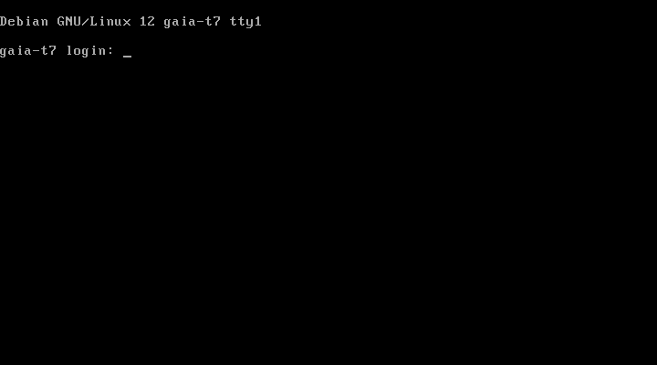
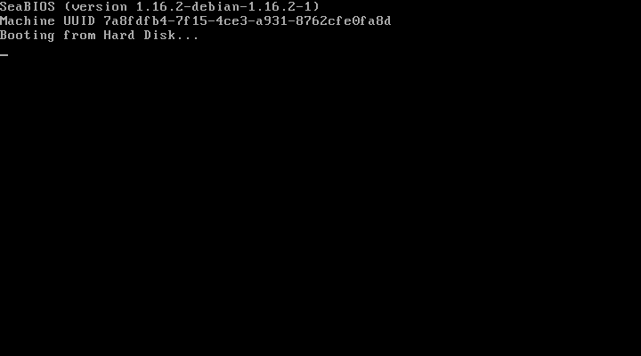

# Rapor: T7 — Verification engine v0: `gaia verify` ve imzalı kanıt

| | |
|---|---|
| Tarih | 2026-11-16 (ölçüm 2026-11-15T21:18:28Z – ~21:23:30Z) |
| Commit | Ölçüm ve kod: `0067bc8` (`vcs.modified=false`) |
| Ortam | Proxmox VE 8.4.21 (AMD Ryzen 7 2700X, `kvm_amd nested=1`). `gaia-lab`: Debian 12, kernel 6.1.0-54-cloud-amd64, nested KVM, libvirt 9.0.0, QEMU 7.2.22, dnsmasq 2.90, go1.25.8. Guest: Debian 12 genericcloud amd64 (sha512 `485a390d…e908e512`), 2 vCPU / 1 GiB, 8 GiB disk, SeaBIOS |
| **Status** | `DONE` — `gaia verify` / `gaia evidence verify`, birim testleri, lab runner ve lab ölçümü tamam |
| **Gate** | `PASS` — (a) restore edilen image → `OK`, imzalı bundle, ledger seq 1; (b) MBR boot kodu sıfırlanmış kopya → `CRITICAL`; (c) 7 tek byte değişikliğinin 7'si `gaia evidence verify` exit 2; (d) restore edilen image'ın sha256'sı testlerden önce ve sonra aynı |

## Mimara özet

- T7 tamam, gate `PASS`. Zincirin tamamı lab'da çalıştı: çalışan guest'in (crash-consistent) full backup'ı alındı (T6 yolu), Kopia'dan restore edildi, `gaia verify` image'ı sandbox'ta boot etti ve check'leri koştu, kanıt imzalanıp ledger'a eklendi.
- **(a)** Restore edilen image `OK`: seri konsolda `gaia-t7 login:` 12.039 s'de, SSH 12.421 s'de, HTTP `/health` 200 12.446 s'de. İki konsol ekran görüntüsü, 11 dosyalık imzalı bundle, ledger seq 1.
- **(b)** MBR boot kodu (bayt 0–439) sıfırlanmış kopya: boot 180 s'de gelmedi → `CRITICAL`. SSH/HTTP `UNKNOWN` ("not run"). Ekran görüntüsünde SeaBIOS `Booting from Hard Disk...` satırında kalmış.
- **(c)** Kopyalar üzerinde tek byte değişikliği: ekran görüntüsü, `result.json` verdict'i, `serial.log`, `manifest.json`, `manifest.sig`, ledger verdict'i, ledger `prev` hash'i. 7/7 exit 2 `CRITICAL`; değiştirilmemiş hâli exit 0. Birim testleri bundle'ın ve ledger'ın **her** byte'ını tek tek değiştiriyor.
- **(d)** Image hiç yazılmıyor: guest qcow2 overlay'de koşuyor. sha256 `75e959c0…ecc319` önce = sonra (runner ayrıca ve `gaia verify` kendisi ölçtü).
- **İzolasyon:** libvirt bridge'i uplink'siz (`<forward>` yok) ve host'un adresi yok (`<ip>` yok, IPv6 kapalı). DHCP ve probe'lar bu bridge'e veth ile bağlı ayrı bir netns'te; default route yok. Guest ne host'a ne dışarıya ulaşabilir; guest boot etmeden önce kontrol ediliyor, değilse guest başlatılmıyor.
- **Proven RTO** (ADR-004 §3): restore 1.203 s + vCPU başlangıcından tüm check'ler geçene kadar 12.446 s = **13.649 s**. `gaia verify`'ın toplamı 28.820 s; image hash'i iki kez 6.5 s ve sandbox kurulumu 1.4 s içeride.
- **Kanıt repo'da:** `docs/reports/evidence/2026-11-16-T7/` (iki bundle, ledger, public key). Herkes doğrulayabilir: `go run ./cmd/gaia evidence verify …` (aşağıda). Mac'te doğrulandı: `OK`.
- **ADR-004 §5 fallback'i kullanıldı:** go-libvirt'in `DomainScreenshot`'u hatalı (MIME'ı yanlış paketten okuyor ve stream'de deadlock). Ekran görüntüsü `virsh screenshot` subprocess'iyle alınıyor.
- **ONAY GEREKİYOR (ADR-004 §3):** Proven RTO tanımı = restore + "guest'in vCPU'su başladıktan tüm check'ler geçene kadar". Sandbox kurulumu ve image hash'i dahil değil. Bu tanım mı kalsın?
- Açık ONAY'lar: ADR-004 §1 referansı (T4), §2 restore varsayılanları (T5), §2 blok boyutu (T6).
- Yeni Go bağımlılığı yok (ed25519, sha256 stdlib). Lab'a `dnsmasq-base`, `iproute2`, `fdisk` paketleri.
- Bu koşuyu ben Proxmox → `gaia-lab` SSH'ı ile başlattım; kod lab'a git bundle ile gitti. Yiğit'ten: push.

## Sonuçlar

### `gate.json` (kelimesi kelimesine)

```json
{
  "a_healthy_ok": {
    "verdict": "OK",
    "bundle": "gaia-t7-20261115T211903Z-01c8dc",
    "ledger_seq": 1,
    "evidence_verify": "OK",
    "pass": true
  },
  "b_broken_critical": {
    "verdict": "CRITICAL",
    "boot": "CRITICAL",
    "pass": true
  },
  "c_tamper_detected": {
    "cases": 7,
    "detected": 7,
    "not_run": 0,
    "untampered_exit": 0,
    "pass": true
  },
  "d_image_unchanged": {
    "sha256_before": "75e959c0e67debf52e4f7573680a25e76e7462caa2102a49e71e90ab10ecc319",
    "sha256_after": "75e959c0e67debf52e4f7573680a25e76e7462caa2102a49e71e90ab10ecc319",
    "verify_reported": [
      true,
      true
    ],
    "pass": true
  },
  "proven_rto_s": 13.648737635,
  "restore_s": 1.202919265,
  "boot_s": 12.038959177,
  "ready_s": 12.44581837,
  "verdict": "OK"
}
```

### Restore edilen image: bundle'daki `result.json` (kelimesi kelimesine)

```json
{
  "format": "gaia-verify-result/v1",
  "bundle_id": "gaia-t7-20261115T211903Z-01c8dc",
  "vm": "gaia-t7",
  "verdict": "OK",
  "checks": [
    {
      "name": "boot",
      "type": "boot_serial",
      "verdict": "OK",
      "seconds": 12.038959177,
      "attempts": 13,
      "detail": "serial console matched \"(?m)login: *$\": \"gaia-t7 login:\""
    },
    {
      "name": "ssh",
      "type": "tcp",
      "verdict": "OK",
      "seconds": 12.420935649,
      "attempts": 1,
      "detail": "connected to 10.254.0.63:22"
    },
    {
      "name": "http-health",
      "type": "http",
      "verdict": "OK",
      "seconds": 12.44581837,
      "attempts": 1,
      "detail": "GET http://10.254.0.63:8080/health: 200"
    },
    {
      "name": "image_unchanged",
      "type": "image_hash",
      "verdict": "OK",
      "seconds": 0,
      "detail": "sha256 before and after are equal"
    }
  ],
  "image": {
    "path": "/var/lib/libvirt/images/gaia-t7-restored.raw",
    "format": "raw",
    "bytes": 8589934592,
    "sha256_before": "75e959c0e67debf52e4f7573680a25e76e7462caa2102a49e71e90ab10ecc319",
    "sha256_after": "75e959c0e67debf52e4f7573680a25e76e7462caa2102a49e71e90ab10ecc319",
    "unchanged": true
  },
  "sandbox": {
    "domain": "gaia-verify-01c8dc",
    "network": "gaia-verify-01c8dc",
    "bridge": "gvb-01c8dc",
    "netns": "gaia-verify-01c8dc",
    "probe_address": "10.254.0.1",
    "guest_ip": "10.254.0.63",
    "virt": "kvm",
    "libvirt": "9.0.0",
    "qemu": "7.2.22",
    "host_addresses_on_bridge": [],
    "netns_routes": [
      "10.254.0.0/24 dev gvn-01c8dc proto kernel scope link src 10.254.0.1",
      "local 10.254.0.1 dev gvn-01c8dc table local proto kernel scope host src 10.254.0.1",
      "broadcast 10.254.0.255 dev gvn-01c8dc table local proto kernel scope link src 10.254.0.1",
      "local 127.0.0.0/8 dev lo table local proto kernel scope host src 127.0.0.1",
      "local 127.0.0.1 dev lo table local proto kernel scope host src 127.0.0.1",
      "broadcast 127.255.255.255 dev lo table local proto kernel scope link src 127.0.0.1",
      "fe80::/64 dev gvn-01c8dc proto kernel metric 256 pref medium",
      "local ::1 dev lo table local proto kernel metric 0 pref medium",
      "local fe80::40cd:22ff:fe33:659c dev gvn-01c8dc table local proto kernel metric 0 pref medium",
      "multicast ff00::/8 dev gvn-01c8dc table local proto kernel metric 256 pref medium"
    ],
    "isolated": true
  },
  "timings_s": {
    "boot": 12.038959177,
    "image_hash": 6.545287969,
    "proven_rto": 13.648737635,
    "ready": 12.44581837,
    "restore": 1.202919265,
    "sandbox_setup": 1.385957012,
    "shutdown": 2.002287385,
    "total": 28.819845604
  },
  "shutdown": "acpi",
  "screenshots": [
    "screenshot-boot.png",
    "screenshot-end.png"
  ],
  "errors": [],
  "started": "2026-11-15T21:19:03.41512234Z",
  "finished": "2026-11-15T21:19:32.234967944Z"
}
```

Konsol, boot tespit edildiği anda (`screenshot-boot.png`):



### Bootloader'ı bozulmuş kopya (`result.json`'dan, `jq -c` ile seçilmiş alanlar)

```json
{"verdict":"CRITICAL","checks":[{"name":"boot","type":"boot_serial","verdict":"CRITICAL","seconds":180.088298708,"attempts":181,"detail":"no match for \"(?m)login: *$\" on the serial console within 180 s"},{"name":"ssh","type":"tcp","verdict":"UNKNOWN","seconds":0,"detail":"not run: the guest did not boot"},{"name":"http-health","type":"http","verdict":"UNKNOWN","seconds":0,"detail":"not run: the guest did not boot"},{"name":"image_unchanged","type":"image_hash","verdict":"OK","seconds":0,"detail":"sha256 before and after are equal"}],"timings_s":{"image_hash":7.075690108,"sandbox_setup":1.441684953,"shutdown":0.371443571,"total":197.724949251},"shutdown":"forced (not booted)","screenshots":["screenshot-boot.png","screenshot-end.png"],"errors":[],"image":{"sha256_before":"44ee4a12310f050cf304bfa00c4f009c002d802757c6f4e72bef00cee6dd4d46","unchanged":true}}
```

`damage.txt`: `damage: zeroed the MBR boot code (bytes 0-439)`. Bozulan, restore edilen image'ın bir kopyası (`cp --sparse=always`); o yüzden sha256'sı farklı (`44ee4a12…`), ama o da test boyunca değişmedi.



### Ledger (`ledger.jsonl`, kelimesi kelimesine)

```json
{"format":"gaia-ledger/v1","seq":1,"time":"2026-11-15T21:19:32.236253965Z","bundle_id":"gaia-t7-20261115T211903Z-01c8dc","bundle_sha256":"472d2acb9e52ac28b2a9e34c7e9dc73bd680798761776d2a19aecb3cd0b95319","subject":"gaia-t7","verdict":"OK","prev":"0000000000000000000000000000000000000000000000000000000000000000","entry_sha256":"6cc068f724219c68b3c554592cb1f97909e027eb2450cbecc8fe842615635bba","sig":"8ITHMeawwpp39eguRPC+rXwf8uWh/YItPi8pnjPfMgXya4NyA3UUQR/8SLznmRXFbdronaRJEaeK8rSUHn1bAQ=="}
{"format":"gaia-ledger/v1","seq":2,"time":"2026-11-15T21:22:50.959258156Z","bundle_id":"gaia-t7-20261115T211933Z-95b30d","bundle_sha256":"e58777f2509b30bda38abd323eedd28913d9f6b77fce26314f827476af3ad128","subject":"gaia-t7","verdict":"CRITICAL","prev":"6cc068f724219c68b3c554592cb1f97909e027eb2450cbecc8fe842615635bba","entry_sha256":"7bad52a83c2a54000e6a9fb5e6fdbc54fbea0dcc6d31ffd58a4a8827b41d3ef1","sig":"irz1eN8/r4nXJM6F484LIw2SZZ+TjUeYZb10T5XXvzSwt5IdRKcKQLKKjiS8szlmKGU4q1bNkFZyckEumUnjCw=="}
```

### Restore edilen image'ın bundle'ı: `manifest.json` (kelimesi kelimesine)

```json
{
  "format": "gaia-evidence/v1",
  "bundle_id": "gaia-t7-20261115T211903Z-01c8dc",
  "created": "2026-11-15T21:19:32.235858348Z",
  "subject": {
    "verdict": "OK",
    "vm": "gaia-t7"
  },
  "key_fingerprint": "dc5109cbb6ddfdb5d329dc1456c0a8bdedec5888e351631f7258e5c081efa367",
  "files": [
    {
      "path": "config.json",
      "sha256": "8a580cd7878395328f43817ae52f88395af329fa0f546ef41a3e2c9ffb0c6ff9",
      "bytes": 670
    },
    {
      "path": "dnsmasq.leases",
      "sha256": "1b92eba4b831e83b2fe3c5329dc932715277599f9db1b88bcaf4c1bda6d57773",
      "bytes": 106
    },
    {
      "path": "dnsmasq.log",
      "sha256": "abad17eb19e102b79a9d9cfbf942bf26529719e17b759b27b554e7a6ace40a25",
      "bytes": 3820
    },
    {
      "path": "domain.xml",
      "sha256": "c5a2479e602df6f8b340ca82f295a2ad3f701b1e2c8de3355467ec8799c84d4f",
      "bytes": 1069
    },
    {
      "path": "network.xml",
      "sha256": "ba0cca4a5ff5abb2c1f73cfe9a802a90a1e1105ab11b5dcde784d5f5a5b78234",
      "bytes": 97
    },
    {
      "path": "restore.json",
      "sha256": "fd38c51acf9eae368d78e3269a32927e06cf0e6e474a7d6982da2bd9a7ac1ccb",
      "bytes": 882
    },
    {
      "path": "result.json",
      "sha256": "f1236589749caa7c0d859e5eab025b05d007a33fbff71ee8766b3cc7c4dd41e9",
      "bytes": 2923
    },
    {
      "path": "sandbox.log",
      "sha256": "c316d0366f966a510f2ba3f79c82085c9a86632506e993841b174419c2e0406c",
      "bytes": 3679
    },
    {
      "path": "screenshot-boot.png",
      "sha256": "1decee0ea8ebc0dfbdce74e0319d274b5b7ab292a0f5c40ab6c9ee804f01b96c",
      "bytes": 1669
    },
    {
      "path": "screenshot-end.png",
      "sha256": "e10b18b3d38d141be8061ffefe09b3cfa404166dada454a5d678d99d5a393e70",
      "bytes": 1661
    },
    {
      "path": "serial.log",
      "sha256": "deb3befe78cd32425a5b5a7b31c58bfc7496a5263805751e978543ed9be71fe7",
      "bytes": 62564
    }
  ]
}
```

`network.xml` (sandbox ağı): `<network><name>gaia-verify-01c8dc</name><bridge name='gvb-01c8dc' stp='off' delay='0'/></network>`

### `gaia evidence verify`: olduğu gibi ve tek byte değişince (kelimesi kelimesine)

```
== gaia evidence verify: as written
exit 0
{"verdict":"OK","entries":2,"bundles":[{"bundle_id":"gaia-t7-20261115T211903Z-01c8dc","files":11,"problems":[]},{"bundle_id":"gaia-t7-20261115T211933Z-95b30d","files":10,"problems":[]}],"problems":[]}
```

`tamper.jsonl`: her vakada `evidence/` ve ledger'ın taze bir kopyası, tek bir byte'ı `XOR 0x01`.

```json
{"case":"screenshot","file":"evidence/gaia-t7-20261115T211903Z-01c8dc/screenshot-boot.png","offset":834,"exit":2,"verdict":"CRITICAL","problems":["screenshot-boot.png: sha256 520194a7bc5cc1af0ea06cbe76a6580984662f51fed8546dc84b620df54e86a5 (1669 bytes), manifest says 1decee0ea8ebc0dfbdce74e0319d274b5b7ab292a0f5c40ab6c9ee804f01b96c (1669 bytes)"]}
{"case":"result-verdict","file":"evidence/gaia-t7-20261115T211933Z-95b30d/result.json","offset":122,"exit":2,"verdict":"CRITICAL","problems":["result.json: sha256 be07ec27155908dabf16ec5d540dda2657c1491fef2aedf75ff38211ad8b9467 (2674 bytes), manifest says 0960a8fa794328183be31e9c5eb30e70408ce721f8ace69e87fcb4c7ecff5072 (2674 bytes)"]}
{"case":"serial-log","file":"evidence/gaia-t7-20261115T211903Z-01c8dc/serial.log","offset":31282,"exit":2,"verdict":"CRITICAL","problems":["serial.log: sha256 b753804664d3b156180e4e04f16f0b6a3fcefee287ed8a70758c20c4b25b9cd0 (62564 bytes), manifest says deb3befe78cd32425a5b5a7b31c58bfc7496a5263805751e978543ed9be71fe7 (62564 bytes)"]}
{"case":"manifest","file":"evidence/gaia-t7-20261115T211903Z-01c8dc/manifest.json","offset":959,"exit":2,"verdict":"CRITICAL","problems":["network.xml: sha256 ba0cca4a5ff5abb2c1f73cfe9a802a90a1e1105ab11b5dcde784d5f5a5b78234 (97 bytes), manifest says ba0cca4a5ff5abb2c1f73cfe9a802`90a1e1105ab11b5dcde784d5f5a5b78234 (97 bytes)","signature does not match manifest.json for key dc5109cbb6ddfdb5d329dc1456c0a8bdedec5888e351631f7258e5c081efa367","manifest sha256 b4978ca47b90e3e08154d1772eec760754bb207a44236f100d196c72b03e2901, ledger seq 1 recorded 472d2acb9e52ac28b2a9e34c7e9dc73bd680798761776d2a19aecb3cd0b95319"]}
{"case":"signature","file":"evidence/gaia-t7-20261115T211933Z-95b30d/manifest.sig","offset":10,"exit":2,"verdict":"CRITICAL","problems":["signature does not match manifest.json for key dc5109cbb6ddfdb5d329dc1456c0a8bdedec5888e351631f7258e5c081efa367"]}
{"case":"ledger-verdict","file":"ledger.jsonl","offset":235,"exit":2,"verdict":"CRITICAL","problems":["line 1: entry hash adc4907c1c361ff46a7297ff3a983f39e91356afb0486b76f0292062cb547e06, recorded 6cc068f724219c68b3c554592cb1f97909e027eb2450cbecc8fe842615635bba"]}
{"case":"ledger-prev","file":"ledger.jsonl","offset":746,"exit":2,"verdict":"CRITICAL","problems":["line 2: prev 7cc068f724219c68b3c554592cb1f97909e027eb2450cbecc8fe842615635bba does not match the entry before (6cc068f724219c68b3c554592cb1f97909e027eb2450cbecc8fe842615635bba)","line 2: entry hash e2d47e97f936b14050e220dad7a516063313640f2247c0137e2a4dbe50bc03ee, recorded 7bad52a83c2a54000e6a9fb5e6fdbc54fbea0dcc6d31ffd58a4a8827b41d3ef1"]}
```

### Backup ve restore (T6 yolu; `t7.log`'dan kelimesi kelimesine)

```
== backup (running guest, crash-consistent) and restore from Kopia
{"verdict":"OK","kind":"full","disk_bytes":8589934592,"changed_bytes":1094451200,"point":"c5d326afbaa56bf05e4c855d5e50a05b","timings_s":{"begin":0.272416947,"data":1.676728217,"end":0.000989513,"extents":0.219015547,"total":2.169263513}}
{"verdict":"OK","stats":{"repo_read_bytes":1287651328,"written_bytes":1287651328,"blocks_written":307,"blocks_hole":1741,"seconds":1.202919265}}
{
  "file": "/var/lib/libvirt/images/gaia-t7-restored.raw",
  "sha256": "75e959c0e67debf52e4f7573680a25e76e7462caa2102a49e71e90ab10ecc319",
  "bytes": 8589934592,
  "seconds": 7.066981,
  "mb_per_s": 1159.1937207698734
}
```

### Lab ortamı (`t7.log`'dan kelimesi kelimesine)

```
== date / commit
2026-11-15T21:18:28Z
0067bc8c7aa463e8a026ddcd2435e0f31f288e7f
output: /root/t7-20261115T211828Z

== build
	build	vcs.revision=0067bc8c7aa463e8a026ddcd2435e0f31f288e7f
	build	vcs.modified=false

== virtualisation
6.1.0-54-cloud-amd64
Compiled against library: libvirt 9.0.0
Using library: libvirt 9.0.0
Using API: QEMU 9.0.0
Running hypervisor: QEMU 7.2.22
Dnsmasq version 2.90  Copyright (c) 2000-2024 Simon Kelley

== guest image
485a390d1c5e3a9f57ebb903654c21044c5d5b5b94de126d28b9d0cd960112dc0536afd1217c45036c331659543c8c8acb5f56dff706c9530f9fe39e2908e512  debian-12-genericcloud-amd64.qcow2
debian-12-genericcloud-amd64.qcow2: OK
```

### Proxmox thin pool (öncesi / sonrası) ve temizlik

```
== öncesi (/root/t7-lvs-before.txt)
  VG  LV                LSize    Data%  Meta% 
  pve data               794.30g 55.93  2.02  
  pve vm-9101-disk-0       4.00m 14.06        
  pve vm-9101-disk-1     200.00g 0.36         
  pve vm-9102-cloudinit    4.00m 9.38         
  pve vm-9102-disk-0     200.00g 10.37        
  ssd ssd               <228.11g 30.83  1.76  
  ssd vm-9102-disk-0      64.00g 2.35         
== sonrası (/root/t7-lvs-after.txt)
  VG  LV                LSize    Data%  Meta% 
  pve data               794.30g 55.94  2.02  
  pve vm-9101-disk-0       4.00m 14.06        
  pve vm-9101-disk-1     200.00g 0.36         
  pve vm-9102-cloudinit    4.00m 9.38         
  pve vm-9102-disk-0     200.00g 10.38        
  ssd ssd               <228.11g 30.83  1.76  
  ssd vm-9102-disk-0      64.00g 2.35         
```

Run sonrası `gaia-lab`'da (SSH ile kontrol edildi):

- `virsh list --all` boş; sadece libvirt'in kendi `default` ağı var (inactive).
- `ip netns list` boş, `/var/lib/libvirt/images` boş, `/var/lib/gaia`'da sadece `images` ve `test.img` kalmış.
- `df /` 18G (öncesiyle aynı).

### Kanıtı kendin doğrula

İki bundle, ledger ve public key `docs/reports/evidence/2026-11-16-T7/`'de; private key lab'da her koşu için üretiliyor ve koşu bitince siliniyor. Repo'nun kökünde:

```bash
go run ./cmd/gaia evidence verify -pubkey docs/reports/evidence/2026-11-16-T7/evidence-pub.pem -ledger docs/reports/evidence/2026-11-16-T7/ledger.jsonl -evidence-dir docs/reports/evidence/2026-11-16-T7/evidence
```

Mac'te çıktısı: `evidence: OK (key dc5109cbb6ddfdb5d329dc1456c0a8bdedec5888e351631f7258e5c081efa367)`, exit 0. Bu dizinde tek bir byte'ı değiştirmek komutu exit 2 yapar.

### Yorum

**Zincir.**

- Kaynak guest çalışırken full backup alındı. Guest pause edilmedi ve quiesce yok; yani bir güç kesintisi anının kopyası (crash-consistent).
- Guest kapatıldı, nokta Kopia'dan raw image'a restore edildi (1.203 s, 1287651328 B).
- Bu image `gaia verify` ile boot etti, journal recovery sonrası login prompt'u geldi ve servisleri cevap verdi.
- T6'nın backup'ı ile T7'nin doğrulaması birbirine bağlandı.

**Sandbox.**

- Guest'in diski, restore edilen image'ı backing file olarak kullanan bir qcow2 overlay. Image'a qemu sadece okuma için erişiyor. `gaia verify` image'ın sha256'sını başta ve sonda alıyor; değişirse `image_unchanged` `CRITICAL` olur. Runner bunu ayrıca `imgtool` ile kontrol etti (gate d).
- Ağ:
  - libvirt'te `<forward>` olmayan (uplink yok) ve `<ip>` olmayan (host'un adresi yok, libvirt DHCP/DNS çalıştırmıyor) bir bridge.
  - Bridge'e veth ile bağlı ayrı bir network namespace (`10.254.0.1/24`); DHCP (dnsmasq) ve probe'lar orada.
  - `gaia verify` guest'i başlatmadan önce bridge'de host adresi olmadığını (`host_addresses_on_bridge: []`) ve netns'te default route olmadığını kontrol ediyor. Bu koşul sağlanmazsa guest başlatılmıyor ve sonuç `UNKNOWN`.
  - Probe'lar `ip netns exec <ns> gaia probe …` olarak koşuyor: ADR-002 #4'ün "in-network probe runner"ı.
- Guest'in ağ yapılandırması MAC'e bağlı (cloud-init `match: macaddress`); sandbox, config'teki kaynak VM MAC'ini kullanıyor. Guest DHCP'den `10.254.0.63` aldı.
- Domain transient; kapatılınca (ACPI, 2.002 s) kendiliğinden kayboluyor. netns, bridge ve overlay ardından siliniyor.

**Check'ler.**

- v0'da üç tip var: `boot_serial` (seri konsolda bir regex), `tcp`, `http` (status + gövde).
- Şablonlar:
  - `linux-basic`: seri konsolda `login:` + TCP 22;
  - `linux-boot`: sadece boot.
- VM'e özel check'ler JSON config'te şablonun üstüne ekleniyor; bu testte HTTP `:8080/health` → 200 ve gövdede `ok`.
- Probe'lar zaman aşımına kadar (120 s) 2 saniyede bir yeniden deneniyor.
- Boot gelmezse probe'lar koşmuyor ve `UNKNOWN` kalıyor: denenmemiş bir check yeşil sayılmıyor.
- Toplam verdict en kötü olan: `CRITICAL` > `UNKNOWN` > `WARNING` > `OK`. Bir harness hatası varsa (ör. ekran görüntüsü alınamadı) verdict en az `UNKNOWN`.

**Kanıt (ADR-002 #3).**

- Bir bundle'da şunlar var: `config.json`, `result.json`, `serial.log`, iki PNG ekran görüntüsü, `domain.xml`, `network.xml`, `sandbox.log` (çalışan her komut ve çıktısı), dnsmasq log'u ve lease'leri, varsa `restore.json`.
- Mühürleme:
  - Her dosyanın sha256'sı `manifest.json`'a yazılıyor.
  - Manifest ed25519 ile imzalanıyor (`manifest.sig`).
  - Manifest'in sha256'sı ledger'a ekleniyor. Her ledger satırı bir öncekinin hash'ini taşıyor ve ayrıca imzalı.
- `gaia evidence verify` şunları yakalıyor:
  - herhangi bir dosyadaki değişikliği;
  - eklenen ya da silinen dosyayı;
  - imzası tutmayan manifest'i;
  - kırık zinciri;
  - başka bir geçerli bundle ile değiştirilmiş bundle'ı (ledger'daki hash tutmaz);
  - ledger'da kaydı olmayan bundle'ı.
- Birim testleri bundle'ın ve ledger'ın her byte'ını tek tek değiştirip hepsinin yakalandığını kontrol ediyor.
- **Sınır:** ledger'ın sonundan satırlar, o satırların bundle'larıyla birlikte silinirse kalan zincir geçerli görünür. Bunu yakalamak için ledger'ın son hash'inin dışarıda bir yere sabitlenmesi gerekir (ADR-002 #3'teki opsiyonel RFC 3161 zaman damgası). v0'da yok.

**Süreler.**

- Boot 12.039 s; bunun büyük kısmı guest'in kendi açılışı. Login prompt'u ile servislerin cevap vermesi arasında 0.4 s.
- `gaia verify`'ın toplamı 28.820 s:
  - image hash'i (8 GiB sparse) 6.545 s, başta ve sonda bir kez daha (sondaki `timings_s`'de ayrı değil);
  - sandbox kurulumu 1.386 s;
  - kapatma 2.002 s.
- Proven RTO (13.649 s) bunları içermiyor; tanım aşağıda `ONAY GEREKİYOR`.

**Ekran görüntüleri.**

- İlk tasarımda go-libvirt'in `DomainScreenshot`'u vardı. Mock'ta bu çağrı iki ayrı hata verdi:
  - (1) MIME tipini çağrının cevabından değil stream'in son (boş) paketinden okuyup "EOF while decoding" ile dönüyor;
  - (2) bir sonraki koşuda `requestStream`'in `deregister`'ı `cmux` kilidini beklerken, kilidi tutan router goroutine'i artık okunmayan bir kanala yazmaya çalıştığı için deadlock'a girdi (goroutine dump ile görüldü).
- ADR-004 §5'e göre `virsh screenshot` subprocess'ine geçildi. libvirt 9 / QEMU 7.2 görüntüyü PNG olarak veriyor; PPM gelirse Go'da PNG'ye çevriliyor.

**Mock.** Lab'dan önce aynı runner Docker'da koştu: libvirt 9.0 / QEMU 7.2 aynı, arm64, KVM yok (TCG), UEFI. Orada sağlam image `OK` (boot 330 s, emülasyon), bozuk ESP'li kopya `CRITICAL`, 6/6 değişiklik yakalandı. Mock iki sorunu lab'dan önce gösterdi:

- `virtio-net`'in iPXE ROM'u eksikti. Sandbox'ta `<rom enabled='no'/>`: disk'ten boot ediliyor, PXE gerekmiyor.
- Yukarıdaki ekran görüntüsü hatası.

**Ölçülmedi:**

- Tekrar sayısı 1.
- Windows guest; seri konsolda `login:` yok, ayrı bir boot tespiti gerekecek (ekran görüntüsü / guest agent).
- UEFI x86 guest; lab'da BIOS, UEFI sadece mock'ta (arm64).
- Guest'in içinden aktif bir "dışarı çıkamıyorum" testi. İzolasyon yapılandırmadan kontrol ediliyor (bridge'de host adresi yok, netns'te route yok), guest'in deneyerek doğrulanmıyor.

## Taslakta yapılan düzeltmeler

Önceki raporları okuyan birinin beklemeyeceği değişiklikler (`0067bc8`):

| Dosya | Değişiklik | Neden |
|---|---|---|
| `lab/lab-vm/setup.sh` | `dnsmasq-base iproute2 fdisk` kuruluyor | Sandbox'ın DHCP'si ve netns'i; `fdisk` (sfdisk) mock'taki ESP bozma işlemi için |
| `Makefile` | `build` artık `bin/gaia`'yı da üretiyor | — |
| `README.md` | Tabloya `cmd/gaia` eklendi | — |
| Lab: `gaia-lab`'ın checkout'u | `0067bc8`'e git bundle ile getirildi (GitHub'a push yok) | Kodu Yiğit push etmeden lab'da koşturmak için. Push sonrası origin ile aynı commit'ler |

Yeni dosyalar:

- `internal/evidence`: ed25519 anahtar üretme ve yükleme (PEM, PKCS#8/PKIX), `Seal`, `VerifyBundle`, imzalı hash-chain ledger (`Append` exclusive lock altında ve bozuk bir ledger'a eklemeyi reddediyor), `VerifyLedger`. Testler: her byte değişikliği; eklenen, silinen ve değiştirilen bundle; yanlış anahtar; satır silme ve sıra değiştirme.
- `internal/verify`: config ve şablonlar, sandbox, check'ler, ekran görüntüsü, kapatma, `result.json`, mühürleme. Birim testleri: config doğrulama, `Worst`/exit code, `httptest` ile probe'lar, PPM→PNG.
- `cmd/gaia`: `verify`, `evidence keygen`, `evidence verify`; dahili `probe` (netns içinde).
- `lab/lab-vm/t7-verify.sh`: lab runner'ı.
  - Kaynak guest; backup → restore → verify; bozuk kopya; yedi değişiklik vakası; `gate.json`; temizlik ve fstrim.
  - Değiştirilecek dosya ya da offset bulunamazsa vaka `not_run` olur ve gate `UNKNOWN` (kontrol edilmemiş = geçmemiş).

## Yeni bağımlılıklar

| Modül / tool | Sürüm | Neden gerekli |
|---|---|---|
| Go | — | Yok. İmza (`crypto/ed25519`), hash, PNG ve HTTP stdlib |
| Debian: `dnsmasq-base`, `iproute2`, `fdisk` (sadece lab) | Debian 12 (dnsmasq 2.90) | Sandbox ağındaki DHCP, network namespace, mock'ta ESP bulma |
| `virsh` (libvirt-clients, zaten kurulu) | 9.0.0 | Ekran görüntüsü: go-libvirt'in `DomainScreenshot`'u hatalı olduğu için ADR-004 §5 fallback'i |

## ADR'lerden sapmalar / öneriler

- **ADR-004 §5'in öngördüğü fallback kullanıldı (sapma değil, raporlanması gereken):** ekran görüntüsü `virsh screenshot` ile. Diğer bütün libvirt çağrıları (ağ, domain, durum, kapatma) go-libvirt ile.
- **ONAY GEREKİYOR — ADR-004 §3, Proven RTO'nun tanımı.**
  - ADR: "the measured time of the last successful restore test".
  - v0'da Proven RTO = restore süresi + guest'in vCPU'ları başladıktan bütün check'ler geçene kadar geçen süre (`ready`). Bu testte 1.203 + 12.446 = 13.649 s.
  - Dahil değil: sandbox kurulumu (1.4 s), image'ın sha256'sı (iki kez ~6.5 s, sadece doğrulama için), kapatma.
  - Seçenekler: (a) böyle kalsın: "servis ne zaman cevap verdi"; (b) `gaia verify`'ın toplam süresi dahil; (c) ikisi de raporlansın.
  - Önerim (a), (c)'deki gibi toplamı da `result.json`'da tutarak (zaten `timings_s.total`).
- Açık ONAY'lar (değişmedi): ADR-004 §1 referansı (T4), §2 restore varsayılanları (T5), §2 blok boyutu (T6).

## Açık sorular

- **Ürün için açık işler (v0'da bilerek yok):**
  - **Anahtar yönetimi:** lab'da her koşu yeni bir anahtar çifti üretiyor. Üründe anahtarın nerede durduğu, rotasyonu ve doğrulayıcıya public key'in nasıl ulaştığı.
  - **Ledger'ın dışarıya sabitlenmesi:** RFC 3161 ya da son hash'in başka bir yere yazılması.
  - **Windows ve UEFI guest'ler için boot tespiti:** seri konsol yerine guest agent ya da ekran görüntüsü.
- **Sandbox'taki guest'in ilk açılışı:** restore edilen image'da cloud-init seed'i yok. Debian'ın `ds-identify`'ı datasource bulamayınca cloud-init'i devre dışı bırakıyor; guest kendi kayıtlı ağ yapılandırmasıyla açıldı. Başka dağıtımlarda bu davranış farklı olabilir.

## Yiğit'ten beklenenler

`0067bc8` (T7 kodu) ve bu raporun commit'ini push et:

```bash
cd ~/Desktop/Works/Warewave/projects/gaia && git push origin main
```

Lab'da yapman gereken bir şey yok: `gaia-lab`'ın checkout'u zaten `0067bc8`'de, geride domain, ağ ya da dosya kalmadı.

## Sonraki adım önerisi

- **T8: migration check, stage 1 (cold).** ESXi fixture'ı (host shell'de, sadece lab), allowlist'li salt-okunur vSphere istemcisi, datastore HTTP ile indirme, `virt-v2v -i vmx`, sonra bu `gaia verify`.
- T8 için ESXi'ye erişim gerekecek. Şifreyi yine Yiğit girer; ben görmem ve yazmam.
