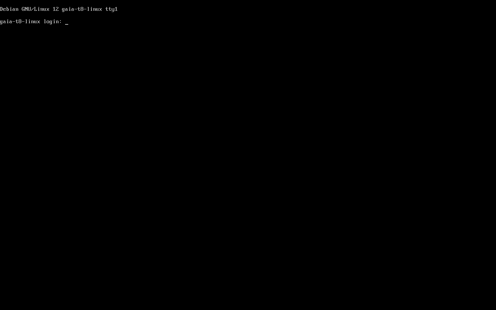
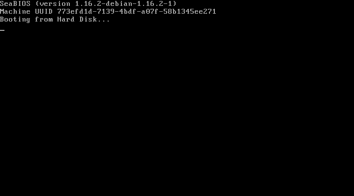

# Rapor: T8 — Migration check, stage 1 (cold)

| | |
|---|---|
| Tarih | 2026-11-16 (raporlanan koşu 2026-11-15T22:19:51Z – ~22:28Z; aynı gün dört lab koşusu, aşağıda "Koşular") |
| Commit | Ölçüm: `90973c6` (`vcs.modified=false`). Kod `0fed0fd`; lab düzeltmeleri `01badcb`, `7a94429`, `bf8ec2e`, `90973c6`; ölçümden sonra `b28df2c` (`ready` süresi) |
| Ortam | Kaynak: free ESXi 8.0.3 build-24677879 (`gaia-esxi`, 192.168.1.29, nested, Proxmox VE 8.4.21). `gaia-lab`: Debian 12, nested KVM, libvirt 9.0.0, QEMU 7.2.22, virt-v2v 2.2.0, nbdkit 1.32.5, go1.25.8. Fixture: Debian 12 generic amd64 (sha512 `ef4e6f33…362e2a`), pvscsi + vmxnet3, BIOS, 3 GiB thin |
| **Status** | `DONE` — Linux ile stage 1 tamam. Windows (stretch) denenmedi; neyin engellediği aşağıda |
| **Gate** | `PASS` — (a) Linux fixture: readiness `OK`, imzalı bundle, ledger seq 1; (b) bootloader'ı bozuk fixture: readiness `CRITICAL`; (c) sıfır yazma: allowlist testleri geçti, call log'da 10 çağrının 10'u okuma, 0 engellenen; ESXi'nin kendi `hostd.log`'unda kontrol boyunca 0 yazma task'ı, VM klasörleri byte'ı byte'ına aynı |

## Mimara özet

- T8 tamam, gate `PASS`. Free ESXi'deki kapalı Debian VM, sadece okuma çağrılarıyla envanterden okundu, klasörü datastore HTTP'den indirildi, `virt-v2v -i vmx` ile qcow2/virtio'ya çevrildi, `gaia verify` sandbox'ında boot etti. VM başına bir imzalı readiness bundle'ı oluştu.
- **(a)** `gaia-t8-linux` → `OK`. İndirme 25.9 s (3 GiB), dönüşüm 33.4 s, boot 17.08 s, SSH ve HTTP `/health` 17.57 s'de. MAC (`00:50:56:3f:a8:01`) dönüşümde korundu, guest DHCP aldı.
- **(b)** `gaia-t8-broken` (MBR boot kodu sıfır): indirme ve dönüşüm `OK`, boot 180 s'de gelmedi → `CRITICAL`. Ekran görüntüsünde SeaBIOS `Booting from Hard Disk...` satırında kalmış.
- **(c)** Salt-okunurluk tek noktada zorlanıyor: govmomi'nin HTTP transport'unda her SOAP gövdesi parse ediliyor, işlem bir allowlist'te değilse istek sunucuya hiç gitmiyor; datastore'a sadece `GET`/`HEAD` `/folder`. vcsim testleri 8 yazma denemesinin 8'inin de host'a ulaşmadığını gösteriyor.
- **(c), host'un gözünden:** `migrate-check` boyunca ESXi `hostd.log`'unda 0 yazma task'ı. 6 okuma task'ı (`SearchIndex.findByInventoryPath`) 6 `GET /folder` ile birebir eşleşiyor. Pozitif kontrol: aynı ölçüm fixture'ın 2 `registerVm` yazmasını yakaladı. VM klasörleri (boyut + tam zaman) önce = sonra.
- **Şeffaflık:** ilk tam koşunun gate'i `CRITICAL`'dı, çünkü benim eklediğim `hostd` kriteri her task'ı yazma sayıyordu. Kanıta göre (task'lar okuma, GET'lerle bire bir) sınıflama düzeltildi. Üçüncü koşuda klasör listesi hiç alınamamıştı (BusyBox `ls -e`); düzeltilip tekrar koşuldu. Raporlanan, dördüncü koşu.
- Kanıt repo'da: `docs/reports/evidence/2026-11-16-T8/` (iki bundle, call log ve virt-v2v log'u içinde). `gaia evidence verify` Mac'te `OK`.
- **Windows (stretch):** denenmedi. Engeller: Microsoft Evaluation ISO'nun lisans kabulü ve indirilmesi (Yiğit'in kararı), virtio-win'in Debian'da paketlenmemiş olması, unattended kurulum. Ayrı bir iş olarak öneriyorum.
- **PO kararı (2026-11-16):** Yiğit açık ONAY maddelerinde önerilerimi kabul etti (ADR-004 §1 `plain_read_s`, §2 restore varsayılanları, §2 blok boyutu ölçümü, §3 Proven RTO tanımı). ADR metinleri mimarın. §1 kararıyla T4 gate'i `FAIL` olur ve Kopia tuning işi açılır.
- Lab: ESXi VM'inin Proxmox diski %0.36 → %8.86. Fixture'lar silindi ama `sata0` `discard` olmadan bağlı olduğundan alan thin pool'a dönmüyor (pool %56.08 → %58.31). Geri kazanma komutu aşağıda; isteğe bağlı.
- Yiğit'ten: push. ESXi parolası `gaia-lab:/root/.gaia-esxi-password`'da duruyor; istersen silebilirsin.

## Sonuçlar

### `gate.json` (kelimesi kelimesine)

```json
{
  "a_linux_ready": {
    "readiness": "OK",
    "bundle": "gaia-t8-linux-20261115T222254Z-ddc918",
    "evidence_verify": "OK",
    "pass": true
  },
  "b_broken_not_ok": {
    "readiness": "CRITICAL",
    "bundle": "gaia-t8-broken-20261115T222418Z-381a35",
    "pass": true
  },
  "c_zero_writes": {
    "allowlist_tests_pass": true,
    "calls": 10,
    "blocked": 0,
    "ops": [
      "GET /folder",
      "Login",
      "Logout",
      "RetrievePropertiesEx",
      "RetrieveServiceContent"
    ],
    "non_read": 0,
    "hostd_write_tasks_during_check": 0,
    "hostd_read_tasks_during_check": 6,
    "get_folder_calls": 6,
    "hostd_write_tasks_by_fixture_positive_control": 2,
    "fixture_vms_unchanged": true,
    "pass": true
  },
  "verdict": "OK"
}
```

### VM başına readiness (`migrate.json`'dan, `jq -c '.vms[] | {vm, readiness, bundle_id, ledger_seq, checks: [...], timings_s}'`)

```json
{"vm":"gaia-t8-linux","readiness":"OK","bundle_id":"gaia-t8-linux-20261115T222254Z-ddc918","ledger_seq":1,"checks":[{"name":"source_vm","verdict":"OK","seconds":0.00017865,"detail":"[datastore1] gaia-t8-linux/gaia-t8-linux.vmx, guest debian12_64Guest, 2 vCPU, 1024 MiB, firmware bios, 1 disk(s), 1 NIC(s)"},{"name":"cold","verdict":"OK","seconds":9E-8,"detail":"poweredOff"},{"name":"layout","verdict":"OK","seconds":0.0000044,"detail":"3 files to read, all in [datastore1] gaia-t8-linux"},{"name":"download","verdict":"OK","seconds":25.881360078,"detail":"3 files, 3221226471 bytes in 25.9 s (GET /folder, sha256 in downloads.json)"},{"name":"conversion","verdict":"OK","seconds":33.35482119,"detail":"gaia-t8-linux-sda (x86_64, bios, 2 vCPU, 1024 MiB, NIC 00:50:56:3f:a8:01) in 33.4 s"},{"name":"boot","verdict":"OK","seconds":17.076162371,"detail":"serial console matched \"(?m)login: *$\": \"gaia-t8-linux login:\""},{"name":"ssh","verdict":"OK","seconds":17.551196337,"detail":"connected to 10.254.0.86:22"},{"name":"http-health","verdict":"OK","seconds":17.571658954,"detail":"GET http://10.254.0.86:8080/health: 200"},{"name":"image_unchanged","verdict":"OK","seconds":0,"detail":"sha256 before and after are equal"}],"timings_s":{"boot":17.076162371,"conversion":33.353807449,"download":25.881349418,"image_hash":0.802748452,"ready":33.35482119,"sandbox_setup":1.563495793,"shutdown":3.018497524,"total":24.515241262}}
{"vm":"gaia-t8-broken","readiness":"CRITICAL","bundle_id":"gaia-t8-broken-20261115T222418Z-381a35","ledger_seq":2,"checks":[{"name":"source_vm","verdict":"OK","seconds":0.00009547,"detail":"[datastore1] gaia-t8-broken/gaia-t8-broken.vmx, guest debian12_64Guest, 2 vCPU, 1024 MiB, firmware bios, 1 disk(s), 1 NIC(s)"},{"name":"cold","verdict":"OK","seconds":9E-8,"detail":"poweredOff"},{"name":"layout","verdict":"OK","seconds":0.00000461,"detail":"3 files to read, all in [datastore1] gaia-t8-broken"},{"name":"download","verdict":"OK","seconds":23.644461796,"detail":"3 files, 3221226474 bytes in 23.6 s (GET /folder, sha256 in downloads.json)"},{"name":"conversion","verdict":"OK","seconds":35.222422605,"detail":"gaia-t8-broken-sda (x86_64, bios, 2 vCPU, 1024 MiB, NIC 00:50:56:3f:a8:02) in 35.2 s"},{"name":"boot","verdict":"CRITICAL","seconds":180.097585195,"detail":"no match for \"(?m)login: *$\" on the serial console within 180 s"},{"name":"ssh","verdict":"UNKNOWN","seconds":0,"detail":"not run: the guest did not boot"},{"name":"http-health","verdict":"UNKNOWN","seconds":0,"detail":"not run: the guest did not boot"},{"name":"image_unchanged","verdict":"OK","seconds":0,"detail":"sha256 before and after are equal"}],"timings_s":{"conversion":35.222039916,"download":23.644450305,"image_hash":0.780865596,"sandbox_setup":1.423919882,"shutdown":0.392202248,"total":184.609976397}}
```

**Bilinen hata, bu koşunun bundle'ında:** `gaia-t8-linux`'un `timings_s.ready` değeri 33.35 s. Bu sayı dönüşüm süresi, `ready` değil. Doğru değer 17.572 s, yani vCPU'lar başladıktan sonra son check'in geçtiği an (`http-health`). Ön check'ler kendi sürelerini taşıyor, ama `ready` hesaplanırken onlar da dahil edilmişti. Hiçbir verdict bu değere bağlı değil. `b28df2c`'de düzeltildi; mühürlü bundle'daki değer ise değiştirilmedi.

### Envanter (aynı dosyadan, `jq -c`)

```json
{"source":"192.168.1.29","product":"VMware ESXi 8.0.3 build-24677879","verdict":"CRITICAL","calls":9,"blocked_calls":0,"inventory":[{"name":"gaia-t8-broken","power_state":"poweredOff","guest_id":"debian12_64Guest","firmware":"bios","cpus":2,"memory_mib":1024,"vmx":"[datastore1] gaia-t8-broken/gaia-t8-broken.vmx","datacenter":"ha-datacenter","disks":[{"label":"Hard disk 1","file":"[datastore1] gaia-t8-broken/gaia-t8-broken.vmdk","capacity_bytes":3221225472,"thin":true}],"nics":[{"label":"Network adapter 1","type":"VirtualVmxnet3","mac":"00:50:56:3f:a8:02"}],"has_snapshots":false},{"name":"gaia-t8-linux","power_state":"poweredOff","guest_id":"debian12_64Guest","firmware":"bios","cpus":2,"memory_mib":1024,"vmx":"[datastore1] gaia-t8-linux/gaia-t8-linux.vmx","datacenter":"ha-datacenter","disks":[{"label":"Hard disk 1","file":"[datastore1] gaia-t8-linux/gaia-t8-linux.vmdk","capacity_bytes":3221225472,"thin":true}],"nics":[{"label":"Network adapter 1","type":"VirtualVmxnet3","mac":"00:50:56:3f:a8:01"}],"has_snapshots":false}]}
```

Run'ın toplam verdict'i `CRITICAL`, çünkü bozuk fixture'ın sonucu bu. `calls: 9` sayısı `Logout`'tan önce alınmış; `Logout` ile birlikte call log'da 10 çağrı var.

### Salt-okunurluğun kanıtı (`t8.log`'dan kelimesi kelimesine)

Allowlist testleri (`go test`, vcsim'e karşı, lab'da):

```
=== RUN   TestSOAPOperation
--- PASS: TestSOAPOperation (0.00s)
=== RUN   TestInventoryThroughGuard
--- PASS: TestInventoryThroughGuard (0.11s)
=== RUN   TestWritesAreBlocked
--- PASS: TestWritesAreBlocked (0.12s)
=== RUN   TestDownload
--- PASS: TestDownload (0.17s)
ok  	github.com/Warewave-Technology/gaia/internal/vsphereread	0.404s
```

`TestWritesAreBlocked` şunları deniyor: `PowerOffVM_Task`, `CreateSnapshot_Task`, `ReconfigVM_Task`, `Destroy_Task`, `UnregisterVM`, `ExportVm`, `CreateContainerView` ve datastore'a `PUT`. Sekizinin de reddedildiğini, hiçbirinin HTTP durum kodu almadığını, yani sunucuya ulaşmadığını kontrol ediyor. Ardından ayrı, guard'sız bir istemciyle VM'in hâlâ açık olduğunu ve snapshot'ının olmadığını doğruluyor.

Gaia'nın call log'u (bu koşuda, `uniq -c`) ve ESXi'nin `hostd.log`'u:

```
== read-only proof
Gaia's call log (method path op allowed status):
      1 GET	/folder/gaia-t8-broken/gaia-t8-broken-flat.vmdk	-	true	200
      1 GET	/folder/gaia-t8-broken/gaia-t8-broken.vmdk	-	true	200
      1 GET	/folder/gaia-t8-broken/gaia-t8-broken.vmx	-	true	200
      1 GET	/folder/gaia-t8-linux/gaia-t8-linux-flat.vmdk	-	true	200
      1 GET	/folder/gaia-t8-linux/gaia-t8-linux.vmdk	-	true	200
      1 GET	/folder/gaia-t8-linux/gaia-t8-linux.vmx	-	true	200
      1 POST	/sdk	Login	true	200
      1 POST	/sdk	Logout	true	200
      1 POST	/sdk	RetrievePropertiesEx	true	200
      1 POST	/sdk	RetrieveServiceContent	true	200
hostd.log while the check ran: 72 lines; write tasks: 0; read tasks: 6 (GET /folder calls: 6)
2026-11-15T22:21:54.282Z In(166) Hostd[263219]: [Originator@6876 sub=Vimsvc.TaskManager opID=req=0000005b151a1510-e34f sid=52dad881 user=root] Task Created : haTask--vim.SearchIndex.findByInventoryPath-1429
2026-11-15T22:21:54.297Z In(166) Hostd[263222]: [Originator@6876 sub=Vimsvc.TaskManager opID=req=0000005abc630980-e358 sid=52dad881 user=root] Task Created : haTask--vim.SearchIndex.findByInventoryPath-1432
2026-11-15T22:21:54.312Z In(166) Hostd[263216]: [Originator@6876 sub=Vimsvc.TaskManager opID=req=0000005b149aa430-e361 sid=52dad881 user=root] Task Created : haTask--vim.SearchIndex.findByInventoryPath-1435
2026-11-15T22:23:18.039Z In(166) Hostd[263231]: [Originator@6876 sub=Vimsvc.TaskManager opID=req=0000005b149aa430-e36e sid=52dad881 user=root] Task Created : haTask--vim.SearchIndex.findByInventoryPath-1439
2026-11-15T22:23:18.106Z In(166) Hostd[263237]: [Originator@6876 sub=Vimsvc.TaskManager opID=req=0000005b151a1510-e377 sid=52dad881 user=root] Task Created : haTask--vim.SearchIndex.findByInventoryPath-1442
2026-11-15T22:23:18.117Z In(166) Hostd[263216]: [Originator@6876 sub=Vimsvc.TaskManager opID=req=0000005b149aa430-e37f sid=52dad881 user=root] Task Created : haTask--vim.SearchIndex.findByInventoryPath-1445
fixture VMs (power state, folder listing) unchanged: true
```

Pozitif kontrol: fixture oluşturulurken aynı log'da görülen yazma task'ları.

```
hostd.log while the fixture was made (positive control): 2 write task(s)
      1   haTask-ha-folder-vm-vim.Folder.registerVm-1405
      1   haTask-ha-folder-vm-vim.Folder.registerVm-1414
```

Fixture VM'leri kontrolden önce (`host-before.txt`). Kontrolden sonraki `host-after.txt` ile `diff` boş çıktı:

```
gaia-t8-linux vmid=9 Powered off
  -rw-------    1 root     root     3221225472 2026-11-15 22:20:35 +0000 gaia-t8-linux-flat.vmdk
  -rw-------    1 root     root           506 2026-11-15 22:20:54 +0000 gaia-t8-linux.vmdk
  -rw-r--r--    1 root     root             0 2026-11-15 22:20:55 +0000 gaia-t8-linux.vmsd
  -rw-r--r--    1 root     root           493 2026-11-15 22:20:54 +0000 gaia-t8-linux.vmx
gaia-t8-broken vmid=10 Powered off
  -rw-------    1 root     root     3221225472 2026-11-15 22:21:28 +0000 gaia-t8-broken-flat.vmdk
  -rw-------    1 root     root           507 2026-11-15 22:21:49 +0000 gaia-t8-broken.vmdk
  -rw-r--r--    1 root     root             0 2026-11-15 22:21:50 +0000 gaia-t8-broken.vmsd
  -rw-r--r--    1 root     root           495 2026-11-15 22:21:49 +0000 gaia-t8-broken.vmx
```

İndirilen dosyalar (datastore yolu, byte, sha256):

```
gaia-t8-linux [datastore1] gaia-t8-linux/gaia-t8-linux.vmx 493 9f8a0723b35d78a94521955a0ebb61cc33b986668563ff38076b334c9594ba15
gaia-t8-linux [datastore1] gaia-t8-linux/gaia-t8-linux.vmdk 506 78e06fcbefb5a399315e336fa2ee101f47537fdb128f1840554e2574de120461
gaia-t8-linux [datastore1] gaia-t8-linux/gaia-t8-linux-flat.vmdk 3221225472 05884f5ed3bdada44074a2f83fd9b52479ccebccef4de1a66e572901de3d8a9b
gaia-t8-broken [datastore1] gaia-t8-broken/gaia-t8-broken.vmx 495 760c9f6812afcc7a30050fa5ccd5373773df761e6dba0d2098b820f7c55df9a4
gaia-t8-broken [datastore1] gaia-t8-broken/gaia-t8-broken.vmdk 507 d1b54105f42d2285971c77aff9d2f7ef5da42ec80e8409e31e81dd70b0d41fd9
gaia-t8-broken [datastore1] gaia-t8-broken/gaia-t8-broken-flat.vmdk 3221225472 9aefb7f8a7085788b6bc79328d3d35b19fcec2317521241419bc3a5fe3bf668c
```

### Dönüşüm (`gaia-t8-linux`, bundle'daki `migration/virt-v2v.log`'un ilerleme satırları)

```
[   0.0] Setting up the source: -i vmx /var/lib/gaia/migrate/gaia-t8-linux/gaia-t8-linux.vmx
[   1.0] Opening the source
[   3.7] Inspecting the source
[   6.0] Checking for sufficient free disk space in the guest
[   6.0] Converting 12.15 to run on KVM
[  28.8] Mapping filesystem data to avoid copying unused and blank areas
[  30.0] Closing the overlay
[  30.2] Assigning disks to buses
[  30.2] Checking if the guest needs BIOS or UEFI to boot
[  30.2] Setting up the destination: -o disk -os /var/lib/libvirt/images/gaia-migrate/gaia-t8-linux
[  31.3] Copying disk 1/1
[  33.3] Creating output metadata
[  33.3] Finishing off
```

Kaynak vmx: pvscsi, vmxnet3, statik MAC `00:50:56:3f:a8:01`, `guestOS = "debian12-64"`, `firmware = "bios"`. Dönüşüm sonrası domain: q35, virtio disk ve NIC, aynı MAC, 1048576 KiB, 2 vCPU.

### Konsol (boot tespit edildiğinde)





### `gaia evidence verify` (lab'da ve Mac'te)

```
{"verdict":"OK","entries":2,"bundles":[{"bundle_id":"gaia-t8-linux-20261115T222254Z-ddc918","files":16,"problems":[]},{"bundle_id":"gaia-t8-broken-20261115T222418Z-381a35","files":16,"problems":[]}]}
```

Repo'daki kopyayı doğrulamak için:

```bash
go run ./cmd/gaia evidence verify -pubkey docs/reports/evidence/2026-11-16-T8/evidence-pub.pem -ledger docs/reports/evidence/2026-11-16-T8/ledger.jsonl -evidence-dir docs/reports/evidence/2026-11-16-T8/evidence
```

Mac'teki çıktı: `evidence: OK (key 93244ce8875d94c6faaccae0e7ba0444da3a5fde9f0bcead84563f7e2b790514)`.

Bir bundle'da T7'deki sandbox dosyalarına ek olarak bir `migration/` klasörü var. İçinde:

- `inventory.json`: kaynak VM'in özellikleri;
- `downloads.json`: her dosyanın byte ve sha256'sı;
- `source.vmx`;
- `virt-v2v.log`;
- `converted-domain.xml`;
- `calls.jsonl`: guard'ın o ana kadarki call log'u.

Çıktıda ESXi parolası olmadığını `gaia-lab`'da `grep -rlF -f /root/.gaia-esxi-password` ile kontrol ettim; parolayı görmeden, sonuç `no-password-in-output`.

### Koşular

| Koşu | Commit | Sonuç | Ne oldu, ne değişti |
|---|---|---|---|
| Duman testi (ESXi'siz) | `0fed0fd` | `OK` | Lab'da yerel bir vmx'ten `virt-v2v` → `gaia verify`. İlk iki denemede `virt-v2v`'nin `nbdkit` ve `libnbd-bin` (`nbdcopy`) bağımlılıkları eksik çıktı; `--no-install-recommends` yüzünden kurulmamışlardı → `01badcb` |
| 1 | `01badcb` | `UNKNOWN` | Fixture: ESXi 8'de `multiextent` modülü yok, hosted (sparse) VMDK içe aktarılamıyor → ham disk VMFS flat extent olarak yükleniyor ve `vmkfstools -i` ile thin klonlanıyor (`7a94429`) |
| 2 | `7a94429` | `CRITICAL` | (a) ve (b) geçti. (c)'de benim `hostd` kriterim her "Task Created"ı yazma saydı. Task'ların altısı da `SearchIndex.findByInventoryPath`'ti: ESXi saati ~1.3 s geride, her GET'e bir task, 3 + 3. Task'lar metot adına göre sınıflanıyor, okumaların GET sayısıyla eşleşmesi şart (`bf8ec2e`) |
| 3 | `bf8ec2e` | `OK` | Ama ESXi BusyBox'ı `ls -e`'yi tanımadığı için klasör listesi hiç alınamamıştı; "değişmedi" sadece güç durumunu karşılaştırdı. `ls -l --full-time`'a geçildi ve listenin varlığı şart koşuldu (`90973c6`) |
| 4 | `90973c6` | `OK` | **Raporlanan koşu** |

### Proxmox thin pool (T8 öncesi / sonrası)

```
== öncesi (/root/t8-lvs-before.txt, 1. koşudan önce)
  VG  LV                LSize    Data%  Meta% 
  pve data               794.30g 56.08  2.02  
  pve vm-9101-disk-0       4.00m 14.06        
  pve vm-9101-disk-1     200.00g 0.36         
  pve vm-9102-cloudinit    4.00m 9.38         
  pve vm-9102-disk-0     200.00g 10.90        
  ssd ssd               <228.11g 30.83  1.76  
  ssd vm-9102-disk-0      64.00g 2.35         
== sonrası (/root/t8-lvs-after.txt, 4. koşudan sonra)
  VG  LV                LSize    Data%  Meta% 
  pve data               794.30g 58.31  2.09  
  pve vm-9101-disk-0       4.00m 14.06        
  pve vm-9101-disk-1     200.00g 8.86         
  pve vm-9102-cloudinit    4.00m 9.38         
  pve vm-9102-disk-0     200.00g 10.92        
  ssd ssd               <228.11g 30.83  1.76  
  ssd vm-9102-disk-0      64.00g 2.35         
```

`gaia-lab` (`vm-9102-disk-0`) temiz kaldı (+0.02). Geride domain, netns ya da dosya yok; sadece `/var/lib/gaia/images` (indirilen image'lar) ve `test.img` var. ESXi'nin diski (`vm-9101-disk-1`) +%8.5 büyüdü, yaklaşık 17 GB. Sebebi: fixture'lar her koşuda 2 × 3 GiB ham veri yazdı ve klonladı (beş kez). Fixture'lar silindi, ama `sata0: local-lvm:vm-9101-disk-1,size=200G,ssd=1` `discard` olmadan bağlı olduğu için VMFS'in boşalttığı bloklar thin pool'a dönmüyor.

### Yorum

**Akış ve süreler** (`gaia-t8-linux`):

- envanter: tek bir property collector okuması;
- indirme: 3221226471 B, 25.9 s ≈ 119 MiB/s;
- dönüşüm: 33.4 s;
- sandbox: kurulum 1.6 s, boot 17.1 s, check'ler 17.6 s'de geçti;
- kapatma: 3.0 s.

Kaynak tarafında bir VM için toplam süre yaklaşık 84 s.

İndirme thin diskin tamamını (3 GiB) taşıyor, sıfırlar dahil. Free ESXi'nin okuma API'leri disk allocation haritası vermiyor. Yerel yazma sparse olduğu için diskte sadece veri yer kaplıyor, ama ağdan geçen byte değişmiyor.

**virt-v2v** (ADR-003 §4: Gaia kanıtlar, taşımaz):

- Debian 12'yi KVM için hazırladı: virtio sürücüleri zaten vardı, initramfs yeniden üretildi, disk ve NIC virtio oldu, MAC korundu.
- Uyarılar:
  - `unknown firmware value 'bios', assuming BIOS`: vmx'teki `firmware = "bios"` değeri; zararsız.
  - `could not determine a way to update the configuration of Grub2`: boot yine geldi.
  - "QEMU Guest Agent will be installed at first boot": sandbox'ta ağ çıkışı yok, kurulamaz; zararsız.
- Dönüşüm, MBR boot kodunu onarmıyor. Bu yüzden bozuk fixture dönüşümü geçti ve hatayı boot yakaladı. Readiness kontrolünün değeri tam olarak bu.

**Salt-okunurluk.** ADR-003 §2'yi üç bağımsız kanıt destekliyor:

1. **Kod:** tek bir boğaz noktası var. Allowlist dışında bir SOAP işlemi ya da `/folder` dışında bir HTTP isteği süreçten hiç çıkmıyor. vcsim testleri bunu yazma denemeleriyle ve sunucunun durumuyla doğruluyor.
2. **Call log:** 10 çağrının 10'u okuma, 0 engellenen. Engellenen bir çağrı bile olsaydı `migrate-check` sonucu en az `CRITICAL` olurdu, çünkü bu Gaia'da bir hata demek olurdu.
3. **Host'un kendi kaydı:** `hostd.log`'da 0 yazma task'ı. Okuma task'ları GET'lerle birebir eşleşiyor. Klasörler önce ve sonra aynı. Ölçümün yazmayı gerçekten görebildiği pozitif kontrolle kanıtlı.

`Login` ve `Logout` bir oturum açıp kapatıyor. Bu, okuma izni için gereken tek durum değişikliği.

**`hostd` task'larının anlamı.** ESXi'nin dosya servisi her `GET /folder?dcPath=…` isteğinde `dcPath`'i `SearchIndex.findByInventoryPath` ile çözüyor ve bunu kendi içinde bir task olarak kaydediyor. Bu bir okuma işlemi. Ama "task oluştu" ile "yazma yapıldı" aynı şey değil. Bunu ikinci koşu gösterdi; kriter kanıta göre düzeltildi.

**Ölçülmedi / kapsam dışı:**

- Windows guest (aşağıda).
- vCenter: birden fazla datacenter. Stage 1 tek datacenter'ı kabul ediyor, fazlası hata veriyor.
- Birden fazla diski olan, snapshot'ı olan ya da diski VM klasörü dışında olan VM'ler. Bunlar `UNKNOWN` ("unsupported layout"); kontrol edilmeden `OK` sayılmıyor.
- UEFI kaynak VM.
- Çalışan VM'ler (stage 2; `cold` check'i `UNKNOWN` veriyor).
- Tekrar sayısı 1.

## Taslakta yapılan düzeltmeler

Önceki raporları okuyan birinin beklemeyeceği değişiklikler:

| Dosya | Değişiklik | Neden |
|---|---|---|
| `internal/verify` (`0fed0fd`) | `Options`'a `PreChecks`, `Extra` ve `SkipReason` eklendi. Image yoksa (ör. dönüşüm başarısız olduysa) guest başlatılmıyor, check'ler `UNKNOWN` oluyor, bundle yine de mühürleniyor | Migration check'in adımları aynı imzalı bundle'a girsin; başarısız bir VM de kanıt üretsin |
| `internal/verify` (`b28df2c`) | `ready` sadece vCPU'lar başladıktan sonraki check'lerden hesaplanıyor | T8 koşusunda ön check'lerin süresi `ready`'ye karışmıştı (yukarıda) |
| `lab/lab-vm/setup.sh` (`0fed0fd`, `01badcb`) | `virt-v2v`, `libguestfs-tools`, `nbdkit`, `libnbd-bin` kuruluyor | `--no-install-recommends` ile `virt-v2v`'nin çıktı aşaması çalışmıyordu |
| `cmd/gaia` | Yeni alt komut: `migrate-check` | — |
| `gaia-lab` | `/root/.gaia-esxi-password` (0600, Yiğit yazdı) | Runner ve fixture parolayı buradan okuyor; hiçbir yere yazılmıyor ya da yazdırılmıyor |

Yeni dosyalar:

- `internal/vsphereread`: guard'lı transport, call log, envanter, sparse ve hash'li datastore indirme, vcsim testleri.
- `internal/migrate`: VM başına ön check'ler (`source_vm`, `cold`, `layout`, `download`, `conversion`) + `gaia verify`; vcsim testi. `virt-v2v` hiç başlatılamazsa sonuç `UNKNOWN`; başlatılıp guest'i reddederse `CRITICAL`.
- `lab/esxi/fixture-t8.sh`: **fixture, sadece lab**. ESXi host shell'inde (SSH, `vmkfstools`, `vim-cmd`) iki kapalı VM oluşturuyor ve siliyor. `cmd/` ve `internal/` dışında.
- `lab/lab-vm/t8-migration.sh`: lab runner'ı.

## Yeni bağımlılıklar

| Modül / tool | Sürüm | Neden gerekli |
|---|---|---|
| Go | — | Yok. govmomi (v0.56.2) zaten vardı. vcsim testleri onun `simulator` paketini kullanıyor |
| Debian (sadece lab): `virt-v2v`, `nbdkit`, `libnbd-bin` | 2.2.0, 1.32.5, 1.14.2 | ADR-003 §4: dönüşüm ayrı bir süreç olarak `virt-v2v` ile |
| Debian (sadece lab): `libguestfs-tools` | 1.48.6 | Fixture hazırlığı (`virt-customize`): hostname, health servisi, ağ, SSH host key'leri |

## ADR'lerden sapmalar / öneriler

Sapma yok:

- vSphere'e sadece okuma çağrıları gitti (ADR-003 §2).
- VDDK yok.
- Dönüşüm `virt-v2v` ile yapıldı (ADR-003 §4).
- Host shell'i sadece fixture için kullanıldı (ADR-003 §6).

**PO kararı (kayıt için, ADR metni mimarın):** Yiğit 2026-11-16'da açık ONAY maddelerinde önerilerimi kabul etti:

- **ADR-004 §1:** gate referansı `plain_read_s`. Buna göre T4 `FAIL` (median 2.388) ve Kopia tuning'i gerekiyor.
- **ADR-004 §2:** restore varsayılanları. Paralel okuma, sınırlı cache, cache repo/hedef diskinde değil.
- **ADR-004 §2:** blok boyutunun (4M / 1M / 256K) gerçek yazma desenleriyle ölçülmesi.
- **ADR-004 §3:** Proven RTO = restore + `ready`.

Mimarın bu kararları ADR'lere işlemesini öneriyorum. Phase 2'nin listesinde bunlar için bir görev yok, sırayı mimar belirlesin.

## Açık sorular

- **Windows (stretch), denenmedi.** Engeller:
  1. Microsoft Evaluation Center ISO'su için lisans kabulü ve yaklaşık 5 GB indirme. Lisans kabulü Yiğit'in kararı.
  2. virtio-win Debian'da paketlenmemiş. Fedora'nın yayınladığı ISO'nun indirilmesi gerekiyor.
  3. Fixture'ın gerçek bir Windows olması için unattended bir kurulum gerekiyor (KVM'de kurulup ESXi'ye taşınabilir).
  4. Windows'ta seri konsolda `login:` yok; boot tespiti için ekran görüntüsü ya da guest agent gerekecek.

  Ayrı bir iş olarak öneriyorum. 1. ve 2. maddeler için Yiğit'in kararı gerekiyor.
- **Ürün için açık işler:**
  - TLS doğrulaması (lab'da `-insecure`).
  - vCenter ve birden fazla datacenter.
  - Çok diskli VM'ler.
  - Snapshot'lı VM'ler (base disk okuması).
  - Thin disklerin sıfırlarının ağdan taşınması (bir allocation haritası yok).
  - `virt-v2v`'nin ortamdan kaynaklanan hatasıyla guest'i reddetmesini ayırt etmek. v0'da çalışıp hata dönen her `virt-v2v` sonucu `CRITICAL` sayılıyor.

## Yiğit'ten beklenenler

Push (T8 kodu, lab düzeltmeleri ve bu rapor):

```bash
cd ~/Desktop/Works/Warewave/projects/gaia && git push origin main
```

İsteğe bağlı, ESXi diskinin thin pool'da kapladığı yaklaşık 17 GB'ı geri kazanmak için. `sata0`'a `discard` eklemek ESXi VM'ini kapatıp açmayı gerektiriyor. Ardından ESXi'de VMFS'in boş bloklarını bildirmek gerekiyor. Proxmox shell'de:

```bash
qm set 9101 --sata0 local-lvm:vm-9101-disk-1,size=200G,ssd=1,discard=on && qm shutdown 9101 && qm start 9101
```

ESXi açıldıktan sonra (birkaç dakika), ESXi'nin kendi shell'inde ya da SSH ile:

```bash
esxcli storage vmfs unmap -l datastore1
```

ESXi parolası `gaia-lab:/root/.gaia-esxi-password`'da duruyor. T8 tekrarlanacaksa kalsın. İstersen sil:

```bash
ssh gaia@192.168.1.30 'sudo rm /root/.gaia-esxi-password'
```

## Sonraki adım önerisi

Phase 2'nin görevleri (T4–T8) tamam. Sırayı mimar belirlesin; benim önerdiğim sıra:

1. ADR-004'e Yiğit'in kararlarını işlemek (mimar).
2. T4'ün `plain_read_s` ile `FAIL`'i için Kopia tuning'i.
3. Blok boyutu ölçümü (T6 runner'ıyla).
4. Windows stretch'i (Yiğit'in lisans ve indirme kararından sonra).
